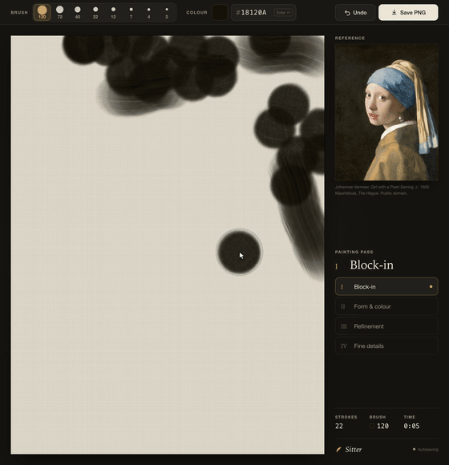
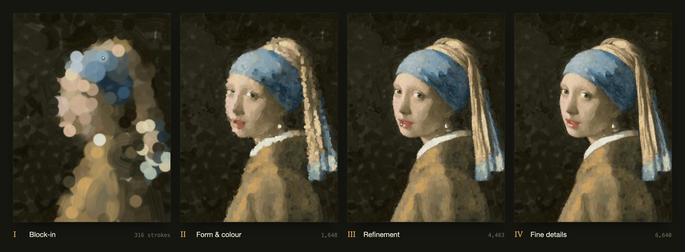
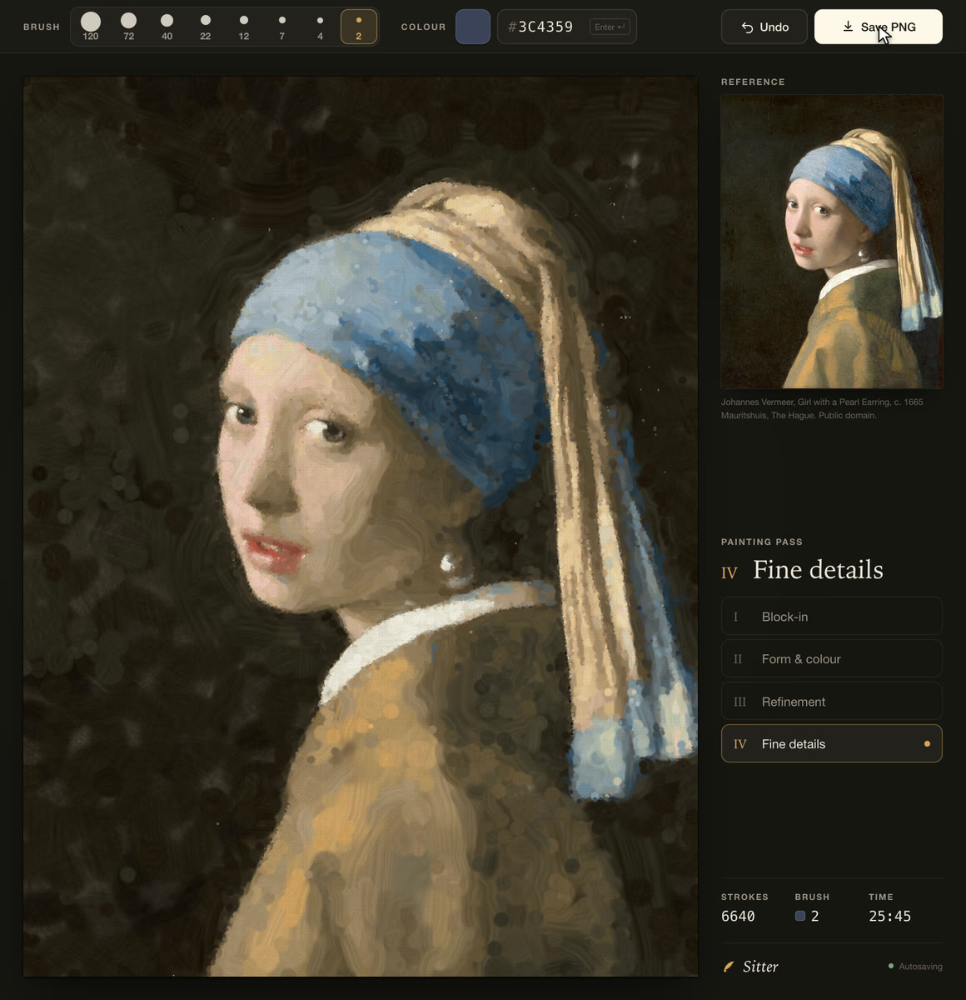

<h1 align="center">Sitter</h1>

<p align="center">
  A portrait painting studio built for computer-use agents.<br>
  Every input is logged, and any session replays as a frame-exact timelapse.
</p>

<p align="center">
  
</p>

Sitter gives an agent the controls a person would use: brush-size buttons, a hex colour field, a pass selector, Undo and Save. The agent paints with real mouse and keyboard input. The studio records every pointer move, click, stroke and colour change to a session file. The replay rebuilds the painting from that log at any speed, with the cursor, the toolbar and the stroke count exactly as they were. It renders straight to a 60 fps video with no screen recorder.

It was built so GPT-6.1 Sol could paint a portrait through computer use. Sol wrote its own stroke planner, proved it offline, and then painted 6,706 strokes by mouse in about 38 minutes. The demo above is the same method on a public-domain painting: 6,640 strokes, planned by [`planner/plan.mjs`](planner/plan.mjs) and painted through real browser input by [`tools/paint.mjs`](tools/paint.mjs).

<p align="center">
  
</p>

## Quick start

You need Node 22 or newer.

```sh
git clone https://github.com/AaravKashyap12/sitter.git
cd sitter
npm install
npm run dev
```

- **Watch the demo:** http://127.0.0.1:5195/?replay=demo/girl-with-a-pearl-earring.json&speed=20&maxGap=0
- **Paint yourself:** add a reference image (see [reference/README.md](reference/README.md)), then open http://127.0.0.1:5195/?new=1

Every session autosaves to `session/` while you paint. Reloading the page continues the same session, and `?new=1` starts a fresh one.

## The studio

<p align="center">
  
</p>

- **One fixed frame:** a 1160 × 1200 studio that scales to the window, with a canvas of 810 × 1080 logical units. Positions mean the same thing at any window size, and the recorded frame is always the same shot.
- **Eight round brushes** (120, 72, 40, 22, 12, 7, 4, 2 units). A click lays one loaded dab. A drag lays a bristled stroke whose paint thins slowly along its length.
- **Opaque paint** that covers, never blends, so tone is built by layering, as with gouache.
- **A hex field** that selects itself on click and applies on Enter. An agent can type a colour in one action.
- **Four passes:** Block-in, Form & colour, Refinement, Fine details. Viewers can see which stage the painting is in.
- **Undo** (button or ⌘Z / Ctrl+Z) and **Save PNG**, which the dev server writes next to the session, so no save dialog interrupts an agent.

## Let an agent paint

[docs/agent-prompt.md](docs/agent-prompt.md) is the prompt behind the first painting. It asks the agent to:
1. write a coarse-to-fine painter
2. prove it offline
3. check that it can send batched real input
4. paint every planned stroke through the UI, checking itself after each pass

Painting by eye produced caricatures. Planning every stroke from the reference produced a likeness.

## Paint without an agent

The planner and the driver do the same job from the command line. Chrome is needed for the driver, and ffmpeg for the planner.

```sh
node planner/plan.mjs reference/portrait.jpg --out planner/out \
  --focus 228,385,412,447 --subject 225,125,810,720
node tools/paint.mjs planner/out/plan.json            # studio must be running
```

- **The planner** scales and crops the image to the canvas, then plans one layer per brush size. Strokes go where the simulated canvas differs most from the reference blurred to that brush's scale, curve along the image's contours, and use a fitted palette per layer. It writes `plan.json`, a preview after each pass, and the final preview. `--focus` and `--subject` boxes (in canvas units) tell it where detail matters most.
- **The driver** opens the studio in a private Chrome and performs the plan through Chrome's input pipeline: clicks, typed colours and dragged strokes at a human pace. Add `--headed` to watch it, or `--pace 0.25` to go faster.

## Make a timelapse

```sh
node tools/clean-session.mjs session/session-NAME.json session/session-NAME-clean.json --cap 250
node tools/capture.mjs "http://127.0.0.1:5195/?replay=session/session-NAME-clean.json&capture=1&speed=20&maxGap=0" out/timelapse.mp4
```

- **`clean-session.mjs`:** by default it drops strokes that were later undone, along with the undo clicks and the time spent on them, so the timelapse never flashes a mistake. The finished painting stays identical. `--cap <ms>` shortens long pauses (an agent thinking, a slow connection) for an even pace.
- **`capture.mjs`:** renders the replay frame by frame in headless Chrome and pipes the frames into ffmpeg. By default it renders the whole replay at 1740 × 1800 and 60 fps, which maps the canvas pixel for pixel. Pass `--frames 0,600,1200` and a folder instead of an `.mp4` to get stills.

Replay URL options:

| parameter | default | |
|---|---|---|
| `replay` | | `session/session-<name>.json` or `demo/<name>.json` |
| `speed` | `1` | playback speed |
| `maxGap`, `gapTo` | `1.5`, `0.4` | after speed is applied, pauses longer than `maxGap` seconds play as `gapTo` seconds; `maxGap=0` turns this off |
| `capture` | | `1` hides the playback bar for rendering |
| `autoplay` | `1` | `0` starts paused |

In the replay, Space plays or pauses, and the arrow keys jump five seconds.

## How it works

- **The log** is the source of truth. The studio applies every event through one reducer, live and in replay, so the replayed toolbar matches what was on screen. The format is documented in [docs/session-format.md](docs/session-format.md).
- **Undo is a tree.** Undo moves to the previous stroke, and painting after an undo starts a new branch. The log keeps everything, and the canvas shows the current branch.
- **The brush is deterministic.** Marks depend only on the stroke's id, size, colour and points, so a replay at 20× speed produces the same pixels as the live painting.
- **The dev server** adds two endpoints: `/api/log`, which appends events, and `/api/save`, which writes the PNG. They accept writes only into `session/`, only from the studio's own origin, and the server listens on 127.0.0.1. Sitter is a local tool, so don't expose the dev server to a network.

## Development

```sh
npm run check   # typecheck, tests, production build
```

`npm run build` produces a static site in `dist/` that can replay the bundled demo. Painting and saving need the dev server.

## Credits

- **Demo reference:** Johannes Vermeer, *Girl with a Pearl Earring*, c. 1665, Mauritshuis, The Hague. Public domain, via [Wikimedia Commons](https://commons.wikimedia.org/wiki/File:1665_Girl_with_a_Pearl_Earring.jpg).
- **The planner** is adapted from the painter GPT-6.1 Sol wrote during Sitter's first painting. It follows Aaron Hertzmann's [Painterly Rendering with Curved Brush Strokes of Multiple Sizes](https://mrl.cs.nyu.edu/publications/painterly98/hertzmann-siggraph98.pdf) (SIGGRAPH 1998).

## Licence

[MIT](LICENSE)
